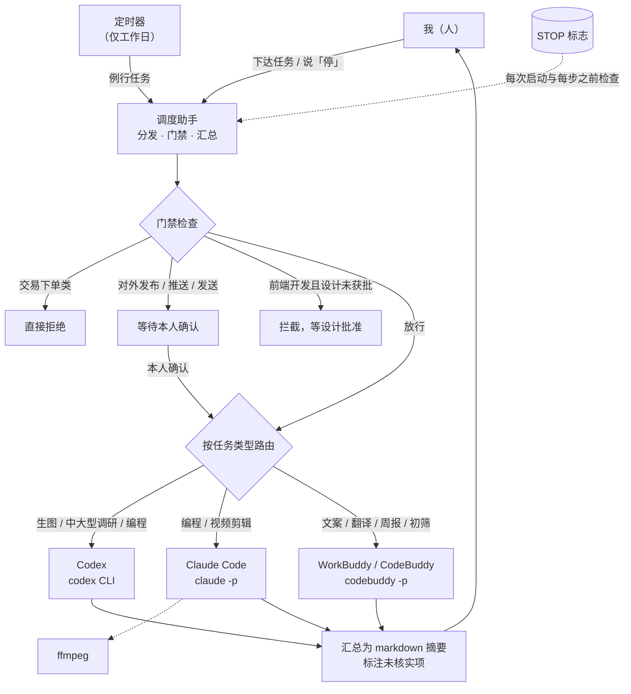

# 个人 AI 多 Bot 协作工作流

> A personal multi-agent workflow: one dispatcher routes tasks to three CLI-based AI executors (Codex, Claude Code, WorkBuddy/CodeBuddy) and merges the results.
> Human-in-the-loop guardrails gate every outward-facing or irreversible action; routine jobs run on weekdays only.
> This repo documents the product design and ships dry-run-by-default shell examples.

这是一个作品集仓库，记录我如何把几个 AI 工具组织成一个“有分工、有门禁、可叫停”的个人工作流。重点不在于写了多少代码，而在于**产品层面的取舍**：谁来分发、谁来执行、哪些动作必须由人确认、哪些任务该停下来省用量。

`examples/` 中的脚本是可运行的最小示例，**默认 dry-run**，只打印执行计划；需要显式加 `--run` 才会真正调用 CLI。

---

## 目录

1. [问题：为什么需要多 Bot 协作](#1-问题为什么需要多-bot-协作)
2. [设计原则](#2-设计原则)
3. [架构图](#3-架构图)
4. [分工表](#4-分工表)
5. [门禁规则](#5-门禁规则)
6. [例行任务排期](#6-例行任务排期)
7. [产品思考与取舍](#7-产品思考与取舍)
8. [仓库结构](#8-仓库结构)
9. [试用示例脚本（dry-run）](#9-试用示例脚本dry-run)
10. [局限与路线图](#10-局限与路线图)

---

## 1. 问题：为什么需要多 Bot 协作

日常要处理的 AI 任务类型很杂：生图、联网调研、写代码、剪视频、写文案、翻译、提炼周报、初筛资料，还有每天固定要跑的硬件监控和新闻早报。直接“哪个顺手用哪个”会遇到几个问题：

| 痛点 | 具体表现 |
|---|---|
| **工具各有所长** | 没有一个工具在所有任务上都合适；每次都要想“这件事该交给谁”。 |
| **上下文来回搬运** | 在多个工具之间复制粘贴任务描述和结果，结果散落各处，难以汇总。 |
| **例行任务重复** | 监控、早报这类任务每个工作日都要做，手动触发容易忘，也没必要周末照跑。 |
| **高风险动作缺少刹车** | 对外发消息、发布、推送、交易这类动作一旦自动执行就难以撤回。 |
| **用量是有限资源** | 订阅/额度有限，重活放在哪里跑、什么时候不跑，本身就是需要设计的事情。 |

所以需要一个**单一入口**来分发和汇总，背后按擅长分工，再加一层**人在环路**的门禁。

## 2. 设计原则

1. **单一入口**：所有任务都发给“调度助手”，由它分发、汇总；我只和一个入口对话。
2. **按擅长分工，CLI 优先**：每个执行者只接自己擅长的任务类型；重活全部走各自的本地 CLI，不开云端编码代理。
3. **人在环路**：关键选型由人决定，执行可以委托；对外发消息/发布/推送前必须本人确认；交易类禁止自动下单。
4. **默认安全**：脚本默认 dry-run；监控只读；修改前先备份、可验收、不改无关配置。
5. **随时可叫停**：一句「停」立即叫停全部，并报告已改内容。
6. **信息分级**：未核实信息不当作事实，在每一步都显式标注。
7. **节约用量**：周末例行任务停休；能用便宜的执行者完成的不用重的。

## 3. 架构图



任务从下达到汇总的时序图见 [docs/architecture.md](docs/architecture.md)。

## 4. 分工表

| 角色 | 调用方式 | 负责的任务 | 不负责 |
|---|---|---|---|
| **调度助手** | 单一入口 | 接收任务、门禁检查、路由分发、汇总结果、转达给本人 | 不亲自做重活；不替人做关键选型 |
| **Codex** | `codex` CLI（联网抓取用 `codex --search exec`） | 生图、中大型调研、编程；新闻网页抓取 | 不对外发布；不下单 |
| **Claude Code** | `claude -p` CLI | 编程、视频剪辑（可配合 ffmpeg）；新闻接力中的分析步骤 | 不覆盖原素材；不改无关配置 |
| **WorkBuddy / CodeBuddy** | `codebuddy -p` CLI | 文案、翻译、周报提炼、资料初筛 | 只出草稿，不发布 |
| **我（人）** | — | 关键选型、对外动作确认、交易决策、设计审批、说「停」 | — |

编程任务两个执行者都能做，示例中默认交给 Claude Code、Codex 作为回退。完整的路由与回退规则见 [docs/routing-rules.md](docs/routing-rules.md)。

## 5. 门禁规则

| # | 规则 | 示例脚本中的实现 |
|---|---|---|
| 1 | 关键选型由人决定，执行可委托 | 任务含“选型/技术栈/最终方案”→ 提示词追加“只出对比方案，不做最终决定” |
| 2 | 对外发消息/发布/推送前必须本人确认 | 含“发布/推送/发送/上线”等词 → 拒绝自动执行；仅在交互终端 `--run --confirm` 并输入「确认」后执行 |
| 3 | 一句「停」立即叫停全部并报告已改内容 | `stop_all.sh --run` 写 STOP 标志；所有脚本启动及每步前检查；同时列出最近修改的文件 |
| 4 | 修改前先备份、可验收、不改无关配置 | 每个委托提示词末尾追加统一“执行守则”，要求列出已改文件与验收方式 |
| 5 | 交易类禁止自动下单 | 含“下单/买入/卖出/开仓/平仓”等词 → 直接拒绝，没有任何参数可绕过 |
| 6 | 设计未获批不开发前端 | 编程任务涉及“前端/页面/界面”且未加 `--design-approved` → 拦截 |
| 7 | 监控只读不杀进程 | `monitor_collect.sh` 只调用只读命令，并把 `kill/pkill/killall` 屏蔽为报错 |
| 8 | 未核实信息不当作事实 | 每步输出扫描 `[未核实]`；缺少来源链接的新闻条目自动视为未核实 |

每条规则的“为什么 / 怎么检查 / 反例”见 [docs/guardrails.md](docs/guardrails.md)。

## 6. 例行任务排期

| 任务 | 时间（仅工作日） | 执行者 / 方式 | 边界 |
|---|---|---|---|
| a) Mac 硬件监控 · 采集 | 9:00 / 13:00 / 17:00 / 21:00 | 本地只读命令（macmon / top / ps 等） | 只读，超阈值只报警，不杀进程 |
| a) Mac 硬件监控 · 日报 | 9:00 | 汇总快照与报警 → 调度助手转给本人 | 只读 |
| b) 新闻早报 | 工作日 9:30（北京时间，可在 crontab 中修改） | `codex --search exec` 抓取 → 分析 | 未核实项必须标注 |
| b) 重大事件提醒 | 10:00 / 14:00 / 18:00 / 22:00 | 同上，只看重大事件 | 无重大事件就说没有 |
| c) 研究类接力 | 跟随新闻流程或按需 | 新闻 → 分析 → 市场核对 | 只分析不下单 |
| d) 周末 | 周六、周日 | — | 例行任务全部停休，省用量 |

cron 写法与停休机制见 [docs/schedules.md](docs/schedules.md) 和 [examples/crontab.example](examples/crontab.example)。

## 7. 产品思考与取舍

### 7.1 CLI 优先 vs 云端编码代理

- **选择**：重活全部走各执行者的本地 CLI（`codex` / `claude -p` / `codebuddy -p`），不开云端编码代理。
- **理由**：省用量；本地 CLI 直接作用于本机文件和工具（如 ffmpeg），结果落在本地，便于备份和验收；调用方式统一，调度层只需拼命令行。
- **代价**：任务受本机在线状态限制；并发能力弱；需要自己处理 CLI 不可用时的回退。
- **缓解**：路由表里为部分任务类型定义回退执行者；没有回退的任务退回给人，而不是静默换一个工具硬做。

### 7.2 单调度 vs 多调度

- **选择**：只有一个调度助手，执行者之间不直接互相派活。
- **理由**：单一入口，我只需要和一个对象说话；门禁只需在一处检查，不会出现“A 绕过门禁让 B 去发布”的情况；汇总口径统一；「停」只需通知一处。
- **代价**：调度助手是单点；复杂任务的多步编排要显式写成接力流程（如研究接力），而不是让执行者自由协商。
- **判断**：对个人工作流而言，可控性比灵活性更重要。

### 7.3 人在环路的确认点放在哪里

不是所有步骤都要人确认，否则自动化没有意义。确认点只放在**不可逆或对外可见**的地方：

| 类别 | 处理 | 原因 |
|---|---|---|
| 关键选型 | 人决定，执行者只出对比 | 选型影响长期，错了返工代价大 |
| 对外发消息 / 发布 / 推送 | 必须本人确认 | 对外可见、难以撤回 |
| 交易下单 | 完全禁止自动化 | 涉及资金，没有“确认后自动执行”这一档 |
| 前端开发 | 设计获批后才开始 | 避免在未定稿的设计上投入开发 |
| 其余执行（调研、草稿、本地改代码） | 委托执行，事后验收 | 可回滚（先备份），保持效率 |

另外，示例脚本在非交互环境（如 cron）下**一律视为未确认**——定时任务永远不可能“自动替我确认”。

### 7.4 周末停休

- **选择**：所有例行任务只在工作日运行；cron 星期字段写 `1-5`，命令前再用 `is_workday.sh` 判断一次。
- **理由**：省用量；周末不需要工作节奏的监控与提醒。
- **代价**：周末发生的重大事件要到周一才会出现在提醒里；需要时可以手动触发。
- **双保险的意义**：`is_workday.sh` 是单独的判断点，将来接入法定节假日表时只需改这一处。

### 7.5 只读监控

- **选择**：监控只采集、只报警，绝不结束进程。
- **理由**：一个自动化脚本“发现 CPU 高就杀掉占用最高的进程”，很可能杀掉的正是我正在用的程序或正在执行的任务；误杀的代价远大于晚一点发现。
- **实现**：只调用只读命令；脚本内把 `kill/pkill/killall` 覆盖为直接报错退出，作为防呆。

### 7.6 研究接力里“未核实不当事实”的处理

研究接力是“新闻 → 分析 → 市场核对”三步，每一步都可能放大上一步的错误。处理方式：

1. **源头标注**：抓取步骤要求每条附来源链接；无链接或来源矛盾的条目标注 `[未核实]`；脚本还会把“没有链接的列表项”自动列为未核实。
2. **标注传递**：分析步骤只能基于给出的材料，不引入新事实；对未核实条目的分析结论也必须带 `[未核实]`。
3. **核对而非补充**：市场核对步骤只做只读核对，结论是“一致 / 不一致 / 无法核对”。
4. **汇总不升级**：汇总里未核实项单独列出，转述时必须保留标注，不会因为“走完了三步”就变成事实。
5. **只分析不下单**：任何一步出现交易指令类词汇，只告警、不执行。

详见 [docs/research-relay.md](docs/research-relay.md)。

## 8. 仓库结构

```text
.
├── README.md                 # 本文件
├── LICENSE                   # MIT
├── .gitignore
├── .shellcheckrc             # ShellCheck 配置（source-path / external-sources）
├── docs/
│   ├── architecture.md       # 组件说明 + 时序图（任务从下达到汇总）
│   ├── routing-rules.md      # 任务类型 → 执行者路由表与回退规则
│   ├── guardrails.md         # 门禁规则：为什么 / 怎么检查 / 反例
│   ├── schedules.md          # 例行任务排期与周末停休
│   └── research-relay.md     # 新闻 → 分析 → 市场核对 接力流程
└── examples/
    ├── lib/common.sh         # 共享库：日志、dry-run、STOP 检查、门禁关键词
    ├── dispatch.sh           # 调度示例：路由 + 门禁 + 汇总
    ├── tasks.example.txt     # dispatch.sh --batch 示例任务（含门禁演示）
    ├── is_workday.sh         # 周末停休判断
    ├── monitor_collect.sh    # 只读硬件监控采集 / 日报
    ├── news_relay.sh         # 新闻接力示例
    ├── stop_all.sh           # 「停」开关 + 已改内容报告
    └── crontab.example       # 例行任务排期示例
```

运行时产生的 `examples/output/`（摘要、报告）和 `examples/.state/`（STOP 标志、监控快照）已加入 `.gitignore`。

## 9. 试用示例脚本（dry-run）

要求：bash（兼容 macOS 自带的 bash 3.2）。**不需要**安装任何 AI CLI 也能跑 dry-run——CLI 不存在时只会警告，照常打印计划。

```bash
cd examples

# 查看用法
./dispatch.sh --help

# 单条任务：默认 dry-run，只打印将要执行的命令并生成摘要
./dispatch.sh --type research --task "调研几种本地向量数据库的部署方式，附来源链接"

# 批量任务：包含门禁演示（发布 → 待确认、下单 → 拒绝、前端 → 拦截、选型 → 只出对比）
./dispatch.sh --batch tasks.example.txt

# 周末停休判断（退出码 0=工作日，1=周末）
./is_workday.sh --date 2026-11-13; echo $?
./is_workday.sh --date 2026-11-14; echo $?

# 硬件监控：dry-run 打印将运行的只读命令；--run 真正采集（只读，Linux 自动降级）
./monitor_collect.sh
./monitor_collect.sh --run
./monitor_collect.sh --mode report --run

# 新闻接力：dry-run 下写入占位输出，演示“未核实”项如何被列出
./news_relay.sh --mode brief
./news_relay.sh --mode alert

# 「停」：dry-run 只展示报告；--run 写 STOP 标志后其他脚本会直接退出（退出码 3）
./stop_all.sh
./stop_all.sh --run --reason "演示叫停"
./dispatch.sh --type copy --task "写一段介绍"     # → 检测到 STOP，退出
./stop_all.sh --clear --run                       # 解除
```

静态检查（在仓库根目录执行，需安装 [ShellCheck](https://www.shellcheck.net/)；`.shellcheckrc` 已配置好 `source` 路径解析）：

```bash
shellcheck -x examples/*.sh examples/lib/common.sh
```

真正执行（`--run`）前请确认：对应 CLI 已安装并登录；你理解每条任务会改动哪些文件。对外动作类任务在 `--run` 下也需要 `--confirm` 并在终端里手动输入「确认」。

## 10. 局限与路线图

**当前局限**

- 门禁基于关键词匹配，存在漏判（换种说法绕过）和误判（如“推送通知的设计文档”）。关键词门禁是第一道防线，不是唯一防线：执行守则同时写进了每条提示词。
- 「停」通过标志文件实现：能阻止新任务和后续步骤，但不会中止已在运行的 CLI 调用；报告只列出在途进程，由人决定是否手动中止。
- 停休只区分周末，未处理法定节假日与调休。
- 调度助手只处理串行任务，没有并发与排队。
- 回退只在“执行者不可用”时触发；执行失败不会自动回退（避免在部分修改的基础上叠加改动）。
- 示例未包含调度助手与聊天入口的对接，也未包含日报/提醒的投递。

**路线图**

- [ ] 门禁从关键词升级为“关键词 + 任务类型 + 由执行者自报动作清单”的组合判断
- [ ] 在途任务的优雅中止（记录 PID，「停」时由人选择是否中止）
- [ ] `is_workday.sh` 接入节假日表
- [ ] 汇总摘要增加“已改文件”与“备份位置”的结构化字段
- [ ] 为示例脚本补充自动化测试

## License

[MIT](LICENSE)
