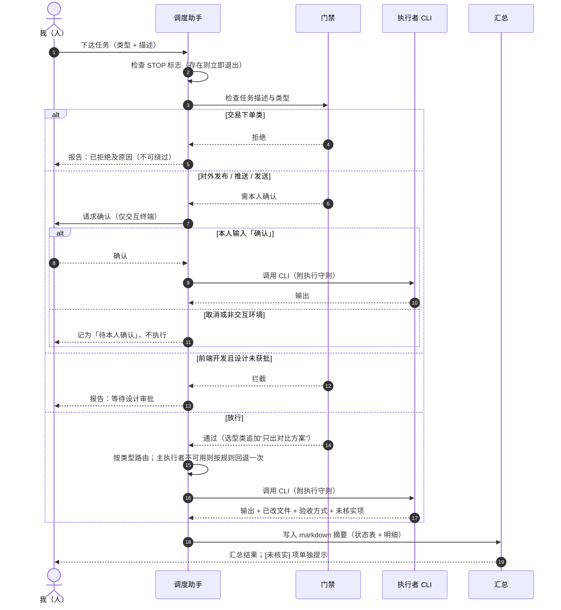
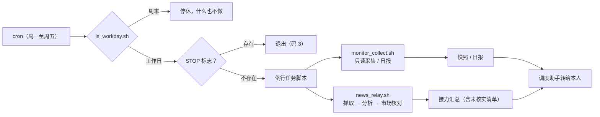

# 架构说明

## 1. 组件

| 组件 | 职责 | 对应示例 |
|---|---|---|
| **调度助手** | 单一入口：接收任务 → 检查 STOP → 门禁 → 路由 → 调用执行者 → 汇总 → 转给本人 | `examples/dispatch.sh` |
| **门禁** | 在路由之前判断任务能否自动执行：放行 / 需本人确认 / 拦截 / 拒绝 | `examples/lib/common.sh` 中的 `gate_check` 等 |
| **执行者** | 三个本地 CLI：`codex`、`claude -p`、`codebuddy -p` | 由 `dispatch.sh` 拼接命令 |
| **执行守则** | 追加在每条委托提示词末尾的统一约束（先备份、不改无关配置、不对外发送、标注未核实、列出已改文件） | `WF_GUARD_SUFFIX` |
| **定时器** | 工作日触发例行任务；周末无条目 | `examples/crontab.example` + `is_workday.sh` |
| **STOP 标志** | 「停」的落地形式：一个文件，所有脚本启动时和每一步之前检查 | `examples/stop_all.sh` |
| **汇总** | 把每条任务的执行者、状态、命令、输出节选、未核实提醒写成一份 markdown | `examples/output/summary-*.md` |

## 2. 任务从下达到汇总（时序图）

## 3. 关键设计点

### 3.1 门禁在路由之前

门禁先于路由执行，意味着无论任务最终会交给哪个执行者、是否发生回退，都经过同一套检查。这也是选择“单调度”的主要原因之一：只有一处入口，就只需维护一处门禁。

### 3.2 两道防线

1. **调度层的关键词门禁**：在调用执行者之前拦截明显的高风险任务。
2. **执行层的执行守则**：写进每条提示词，约束执行者在执行过程中不做对外动作、不改无关配置、先备份。

关键词门禁可能漏判，执行守则作为第二道防线兜底；两者都不替代“对外动作必须本人确认”这一条人的判断。

### 3.3 dry-run 默认

所有示例脚本默认只打印计划。这样做的产品含义是：**“看一眼将要发生什么”是零成本的**，而“真正执行”需要一个显式动作（`--run`）。

### 3.4 汇总口径

- 每条任务一行状态：完成 / 计划（dry-run）/ 待本人确认 / 已拦截 / 已拒绝 / 失败。
- 被门禁拦截不视为错误（退出码 0）；`--run` 下执行失败才返回非 0。
- 执行者输出中出现 `[未核实]` 时，汇总中附加提醒：不作为事实引用。

## 4. 例行任务的数据流

