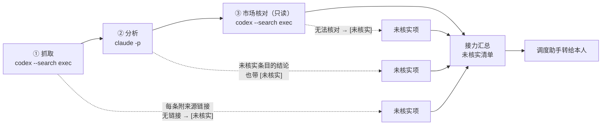

# 研究类接力：新闻 → 分析 → 市场核对

## 1. 流程概览



流程的终点是“转给本人”，图中没有任何一个节点连向交易下单——这是有意的设计。示例实现：`examples/news_relay.sh`。

## 2. 各步骤输入与输出

| 步骤 | 执行者 | 输入 | 要求 | 输出 |
|---|---|---|---|---|
| ① 抓取 | `codex --search exec` | 主题、模式（早报 / 重大事件提醒） | 每条一行：标题 — 一句话摘要 — 来源链接；无可访问来源或来源矛盾的标注 `[未核实]`；提醒模式下没有重大事件就输出「无重大事件」 | `01-fetch.md` |
| ② 分析 | `claude -p` | ① 的完整输出 | 只基于给出的材料，不引入新事实；未核实条目的分析结论也标注 `[未核实]`；不给出任何交易操作指令 | `02-analysis.md` |
| ③ 市场核对 | `codex --search exec` | ② 的完整输出 | 只读核对其中提到的公开市场信息；逐条给出“一致 / 不一致 / 无法核对”+ 来源链接；无法核对的标注 `[未核实]` | `03-market-check.md` |
| 汇总 | 脚本 | ①②③ 的输出 | 列出每步的未核实项；注明边界 | `relay-summary.md` |

每一步开始前都会检查 STOP 标志，「停」可以在接力中途生效。

## 3. “未核实”的处理规则

### 3.1 标注从哪里来

1. **执行者自报**：提示词要求执行者对无法核实的内容标注 `[未核实]`。
2. **脚本补判**：抓取步骤中，没有 `http(s)://` 链接且未标注的列表项，脚本自动列为“缺少来源链接，视为 `[未核实]`”。执行者忘记标注时，这一层兜底。

### 3.2 标注如何传递

- 分析步骤拿到的是带标注的原文，提示词要求对未核实条目的结论同样标注。
- 市场核对的结论分三档，“无法核对”不等于“不一致”，也不等于“一致”，统一按未核实处理。
- **只有在核对步骤中给出来源且结果为“一致”的内容，才可以在转述时去掉“未核实”的说法**；其余一律保留标注。

### 3.3 汇总中如何呈现

- 每一步单独列出未核实项（含行号），而不是只给一个总数。
- 汇总开头注明：`[未核实]` 项不作为事实引用，转述时必须保留标注。
- 走完三步不会让一条信息自动“升级”为事实。

## 4. “只分析不下单”的边界

| 允许 | 不允许 |
|---|---|
| 抓取公开新闻与公告 | 登录任何交易账户 |
| 分析事件可能的影响 | 给出“买入 / 卖出 / 加仓 / 减仓”等操作指令 |
| 只读查询公开的指数、价格、公告以核对分析中的说法 | 生成可直接执行的委托单或下单参数 |
| 在汇总中列出不确定性和风险 | 根据分析结果自动触发任何交易动作 |
| 由本人阅读汇总后**自行决定、手动操作** | 把汇总当作交易建议转发给他人 |

**怎么保证**：

1. 工作流中不配置任何交易账户凭据，执行者没有下单的“手”。
2. 每一步的提示词都写明只分析不下单。
3. 脚本扫描每步输出，若出现交易指令类词汇，只告警并在汇总中标注“已忽略，不执行”。
4. `dispatch.sh` 对含交易下单词的任务直接拒绝，无参数可绕过。

## 5. 试用

```bash
cd examples
./news_relay.sh --mode brief                    # dry-run：打印三步命令，写入占位输出
./news_relay.sh --mode alert --topic "半导体"   # 重大事件提醒模式
```

dry-run 的占位输出中故意包含一条“有链接”、一条“缺链接”、一条“已标注未核实”的示例条目，用来演示未核实清单的生成方式。

## 6. 已知局限

- “有链接”不等于“已核实”：脚本只能检查链接是否存在，不能检查链接内容是否支持该说法，这部分依赖核对步骤和人的判断。
- 各步骤之间通过完整文本传递，输出较长时提示词也会变长。
- 重大事件的“重大”由执行者判断，标准可能不稳定。
