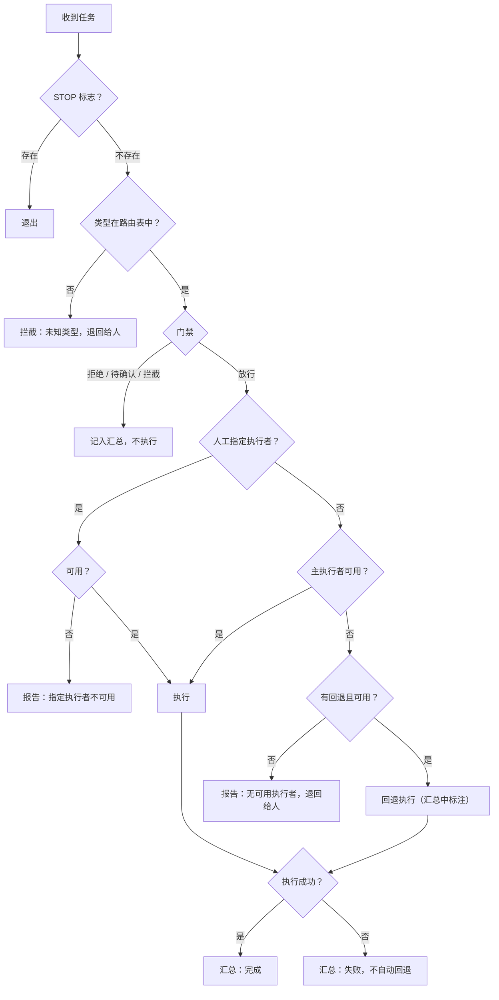

# 路由规则：任务类型 → 执行者

## 1. 路由表

| 任务类型 | `--type` | 主执行者 | 调用形式 | 回退执行者 | 附加要求（追加到提示词） |
|---|---|---|---|---|---|
| 生图 | `image` | Codex | `codex exec "<提示词>"` | 无 → 退回给人 | 保存为新文件，不覆盖已有文件 |
| 中大型调研 | `research` | Codex | `codex --search exec "<提示词>"` | Claude Code（降级） | 结论 + 依据 + 来源链接；无法核实标注 `[未核实]` |
| 编程 | `code` | Claude Code | `claude -p "<提示词>"` | Codex | 先备份或新分支；只改相关文件；给出验收方式 |
| 视频剪辑 | `video` | Claude Code | `claude -p "<提示词>"`（可调用 ffmpeg） | 无 → 退回给人 | 不覆盖原素材；输出新文件；列出所用命令 |
| 文案 | `copy` | WorkBuddy/CodeBuddy | `codebuddy -p "<提示词>"` | Claude Code | 只出草稿，不发布 |
| 翻译 | `translate` | WorkBuddy/CodeBuddy | `codebuddy -p "<提示词>"` | Claude Code | 保留格式；不确定的术语标注 |
| 周报提炼 | `weekly` | WorkBuddy/CodeBuddy | `codebuddy -p "<提示词>"` | Claude Code | 不补充材料中没有的事实 |
| 资料初筛 | `screen` | WorkBuddy/CodeBuddy | `codebuddy -p "<提示词>"` | Claude Code | 逐条标注相关/不相关及理由，不下最终结论 |

例行任务中的网页抓取（新闻早报、重大事件提醒、市场核对）统一使用 `codex --search exec`；新闻分析使用 `claude -p`。

所有提示词末尾都会追加统一的执行守则（见 [guardrails.md](guardrails.md)）。

## 2. 为什么这样分

- **Codex**：负责需要联网检索（调研、新闻抓取）和生图的任务，也能编程。
- **Claude Code**：负责编程和需要操作本机工具链的任务（视频剪辑配合 ffmpeg）。
- **WorkBuddy/CodeBuddy**：负责以文字处理为主的轻任务（文案、翻译、周报、初筛）。
- **编程有两个可选执行者**：示例中默认 Claude Code、回退 Codex；也可以用 `--executor` 人工指定。

## 3. 回退规则

1. **门禁先于路由**：任何任务先过门禁，被拦截/拒绝的任务不进入路由，也不会因为回退而“换个执行者绕过去”。
2. **只在“不可用”时回退**：主执行者 CLI 不存在或无法启动时，才切换到回退执行者。
3. **执行失败不自动回退**：执行者已经开始运行但返回失败，可能已经改了部分文件；此时再换执行者在其基础上继续改，风险更大。失败记入汇总，退回给人判断。
4. **最多回退一次**：回退执行者也不可用时，不再继续尝试，直接退回给人。
5. **没有回退的类型退回给人**：生图、视频剪辑依赖特定能力（生图能力、本机素材与 ffmpeg），不静默换一个不擅长的工具硬做。
6. **降级必须标注**：调研回退到不联网的执行者时，汇总中注明“回退执行者无联网检索，结论全部视为 `[未核实]`”。
7. **人工指定优先**：`--executor` 指定了执行者时，不再自动回退；指定的执行者不可用则直接报告。
8. **未知类型不猜**：任务类型不在路由表中时，不根据描述猜测路由，直接拦截并列出可选类型。

## 4. 路由决策流程

## 5. 对应实现

- 路由：`examples/dispatch.sh` 中的 `route_primary` / `route_fallback` / `build_cmd`
- 附加要求：`type_hint`
- 演示：`./dispatch.sh --batch tasks.example.txt`
